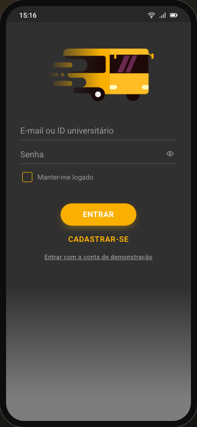
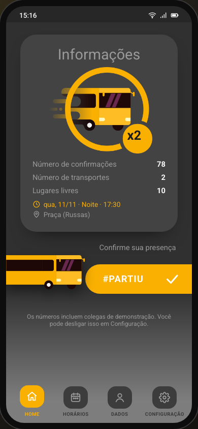
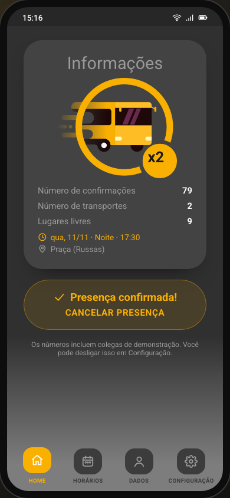
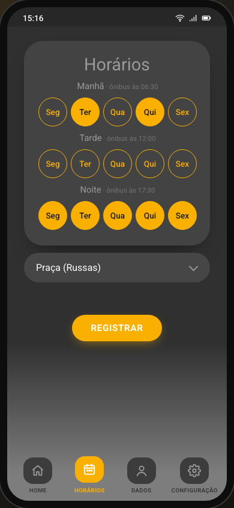
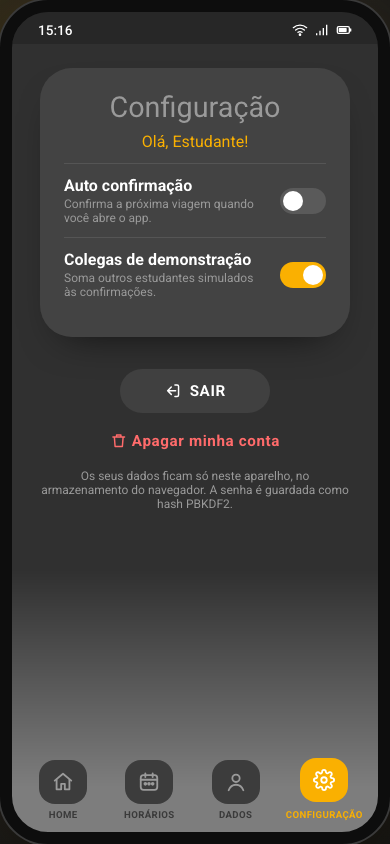
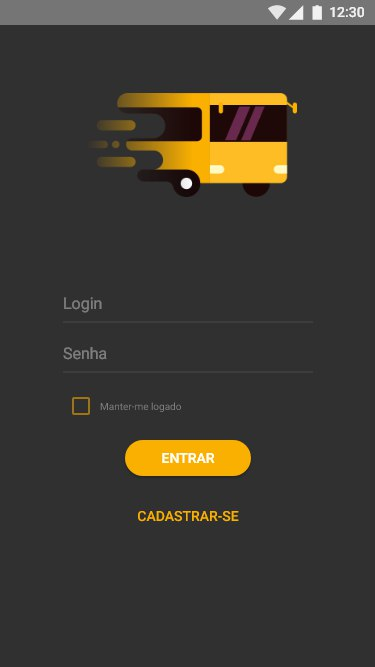
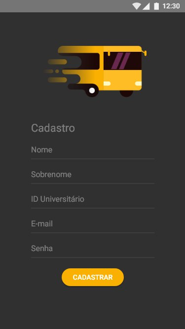
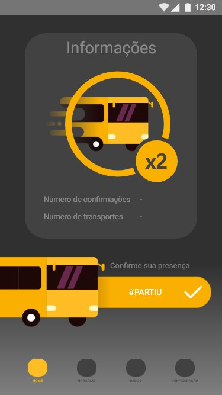
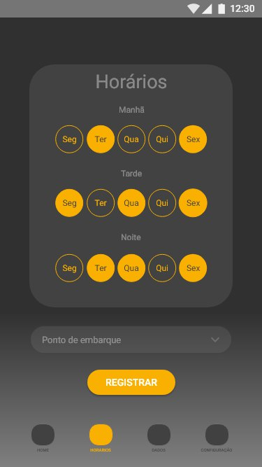
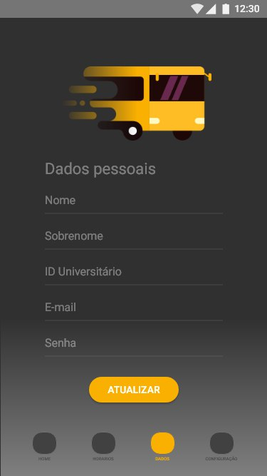

# PartiuFacul

[](https://github.com/rahelmartim/partiu-facul/actions/workflows/tests.yml)
[](https://rahelmartim.github.io/partiu-facul/)

A mobile web app for students who take the university bus. You register the shifts of your classes and your boarding point. Before each trip, you confirm the ride with **#PARTIU**. The app shows how many students confirmed and how many buses the trip needs.

Live app: https://rahelmartim.github.io/partiu-facul/

On a computer, the app opens inside a phone frame. On a phone, it fills the screen, and you can install it with "Add to Home Screen". The app text is in Brazilian Portuguese.

| Login | Home | #PARTIU | Schedule | Settings |
| --- | --- | --- | --- | --- |
|  |  |  |  |  |

## Features

- Sign-up and login with your e-mail or student ID, and an option to keep you logged in
- A weekly schedule: morning, afternoon, and evening shifts from Monday to Friday, and a boarding point
- The next trip of your schedule, with its date, shift, departure time, and boarding point
- **#PARTIU**: drag the bus to the right to confirm the ride. A tap, Enter, or Space also confirm it. You can cancel until the bus leaves.
- The number of confirmations, the number of buses (44 seats each), and the free seats
- Auto-confirm: when you open the app, it confirms the next trip. It never undoes a cancel that you made.
- Demo classmates: simulated students for each trip, so that the counter is realistic. You can turn them off.
- Your personal data and password, which you can change, and an option to delete your account
- Offline use, through a service worker

## How it works

The app has no server. It keeps all its data in the storage of the browser on your device:

- **Accounts:** the password is never stored. The app keeps a PBKDF2 hash with SHA-256, a random salt, and 100,000 iterations. After 5 failed logins, the login is blocked for 30 seconds.
- **Sessions:** with "Manter-me logado", the session stays in `localStorage`. Without it, the session is in `sessionStorage`. When you close the tab, the session ends.
- **Confirmations:** they are stored for each trip. A trip is a date and a shift, for example `2026-11-11:noite`. The number of buses is the number of confirmations divided by 44, rounded up.

Because the data stays on one device, the confirmations of other students do not reach you. The demo classmates show how the counter behaves with a full class. A real deployment needs a server for the shared confirmations.

The app shows all text through text nodes and never inserts data as HTML.

## Getting started

You need [Node.js](https://nodejs.org) 20 or later to run the tests. The app itself has no dependencies and no build step.

1. Serve the folder with any static web server, for example:

   ```bash
   python3 -m http.server 8080
   ```

2. Open http://localhost:8080.

3. To try the app quickly, select **Entrar com a conta de demonstração**. It creates a demo account with a schedule.

## Tests

```bash
npm test
```

The tests use only the built-in test runner of Node.js. There are 118 tests:

| File | What it tests |
| --- | --- |
| `tests/auth.test.js` | Sign-up, login, sessions, the login lock, profile updates, and account removal. |
| `tests/crypto.test.js` | Password hashing, and the comparison of a password with its hash. |
| `tests/validation.test.js` | The rules for names, e-mails, student IDs, and passwords. |
| `tests/schedule.test.js` | The weekly schedule and the next trip, also across weekends. |
| `tests/trips.test.js` | Confirmations, cancels, departure times, bus counts, and auto-confirm. |
| `tests/demo.test.js` | The demo classmates. |
| `tests/dates.test.js`, `tests/storage.test.js`, `tests/settings.test.js` | Dates, storage, and settings. |
| `tests/static.test.js` | The files that the app, the service worker, and the manifest refer to. |
| `tests/app.browser.test.js` | The real app in a headless Chrome: every screen, the forms, #PARTIU by tap and by drag, the settings, the sessions in new tabs, and the phone layout. |

The browser tests control Chrome through the Chrome DevTools Protocol, with the WebSocket of Node.js. They look for Chrome in the usual places, or in `CHROME_PATH`. Without Chrome, they are skipped.

To update the screenshots of this README, run `node scripts/screenshots.js`.

## Project structure

```text
index.html             # The page and the phone frame
manifest.webmanifest   # Install data for phones
sw.js                  # Service worker for offline use
src/
├── lib/               # Logic without DOM code: accounts, schedules, trips, storage
├── ui/                # Screens, the #PARTIU control, and DOM helpers
├── main.js            # Start-up
└── styles.css         # Styles in the colors of the original app
assets/                # Images of the original app, and the app icons
docs/                  # Screenshots and the original mockups
scripts/               # The screenshot script
tests/                 # Tests
```

## History

PartiuFacul started in 2018 as a project for a software maintenance course: an Android app in Kotlin with a Ruby on Rails API. That version was not finished. In 2026, it became this web app. The images, the colors, and the screens come from the original design.

| Login | Sign-up | Home | Schedule | Personal data |
| --- | --- | --- | --- | --- |
|  |  |  |  |  |

The code of the first version is in the git history.

## License

This project uses the MIT license. Read the [LICENSE](LICENSE) file for the full text.
